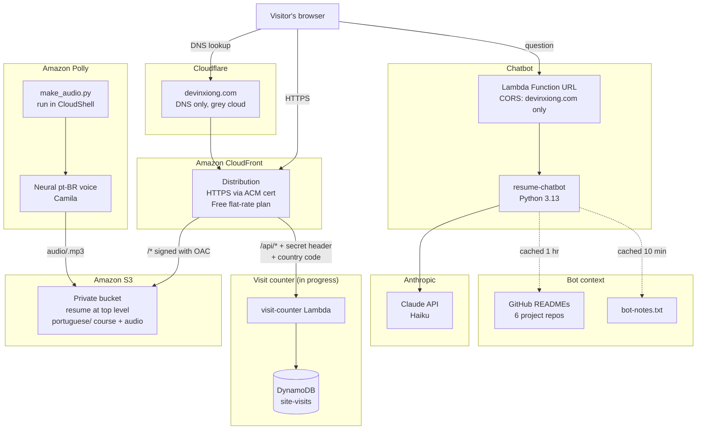

# Architecture

## System Overview

---

## Request Flows

### Loading the site
1. The browser looks up `devinxiong.com` on Cloudflare DNS, which points to CloudFront.
2. CloudFront serves the page over HTTPS using the ACM certificate.
3. If CloudFront has a cached copy, it serves that. If not, it fetches the file from S3.
4. The bucket is private. CloudFront signs the request with **Origin Access Control**, and the bucket policy only allows this one distribution.

### Asking the chatbot a question
1. `script.js` sends the question to the Lambda Function URL.
2. Lambda checks the request came from `devinxiong.com` and that the question is under 500 characters.
3. Lambda builds the prompt: my resume, `bot-notes.txt`, and my GitHub READMEs (both cached so they're not fetched every time).
4. Lambda calls Claude and returns the answer as JSON.
5. The page inserts the answer as plain text, never as HTML.

### Running a mock ticket
Same as above, but if the question contains "mock ticket", Lambda asks Claude for **structured JSON** (priority, category, summary, steps, related repo) using a JSON schema. The page renders it as a ticket card, so every ticket has the same shape.

### Counting a visit (in progress)
1. `script.js` calls `/api/visit` on the same domain, once per browser session.
2. CloudFront routes `/api/*` to the visit-counter Lambda and adds two headers: the visitor's two-letter **country code**, and a **secret header** only CloudFront knows.
3. Lambda rejects anything without the secret, then adds 1 to the total and to that country in DynamoDB.
4. Only the country code is stored. No IP addresses.

### Playing Portuguese audio
1. A lesson phrase like *Bom dia* is a button on the page.
2. When tapped, `course.js` computes an id: the first 16 hex characters of the phrase's SHA-1.
3. It plays `portuguese/audio/<id>.mp3` from CloudFront. `make_audio.py` created that file earlier with Polly, using the same id.
4. If the recording doesn't exist, it falls back to a Brazilian (`pt-BR`) browser voice, never a Portugal one.

### Keeping the course separate from the resume
The resume lives at the top level of the bucket and the course lives under the `portuguese/` prefix. Both have an `index.html`, so the prefix is the only thing keeping one from overwriting the other.

---

## Design Decisions

| Decision | What I chose | Why | When I'd change it |
|---|---|---|---|
| Public S3 website vs CloudFront | Private bucket + CloudFront with OAC | Bucket never exposed, HTTPS on my domain, nobody can bypass the CDN | Never for anything real |
| CloudFront pricing | Free flat-rate plan | No overage charges, so a spike can't become a surprise bill | If traffic outgrew the plan's limits |
| Domain registrar | Cloudflare | About $10/yr vs about $21/yr on Route 53 with a hosted zone | If I wanted everything in AWS |
| Cloudflare proxy | Off (DNS only) | CloudFront already caches and blocks DDoS. Proxying broke cert validation | Never, while CloudFront is in front |
| API Gateway vs Function URL | Function URL | One endpoint, free, fewer moving parts | If I needed throttling or API keys |
| Secrets Manager vs env variable | Environment variable | Encrypted at rest, simple, saves about $0.40/mo | For production, with rotation |
| Model size | Claude Haiku | Answering from a resume is simple. About $0.001 per question | If the bot needed harder reasoning |
| Vector database vs prompt context | Prompt context | My data is small enough to fit in one request | If it grew to hundreds of documents |
| Free text vs structured output for tickets | Structured JSON | Same shape every time, can't break the page layout | — |
| Visit tracking | Country code only | Enough to see reach without storing anything personal | — |
| Browser speech vs Amazon Polly | Polly neural pt-BR, pre-generated | Browser voices vary by device, and Brave has no Brazilian voice | — |
| Audio lookup | SHA-1 of the phrase as the file name | Browser and script compute the same id, so no manifest file is needed | If phrases needed per-voice variants |
| Course pages | One lesson template + a JSON file per week | Adding a week is data, not code | — |

---

## Cost

| Item | Cost |
|------|------|
| S3 + CloudFront (Free plan) | $0 |
| Lambda + DynamoDB at this traffic | ~$0 (free tier) |
| Claude API | ~$0.001 per question, hard cap $5 prepaid |
| Amazon Polly (neural) | ~$16 per million characters, well under $1 for the whole course, generated once |
| Domain (Cloudflare) | ~$10/year |